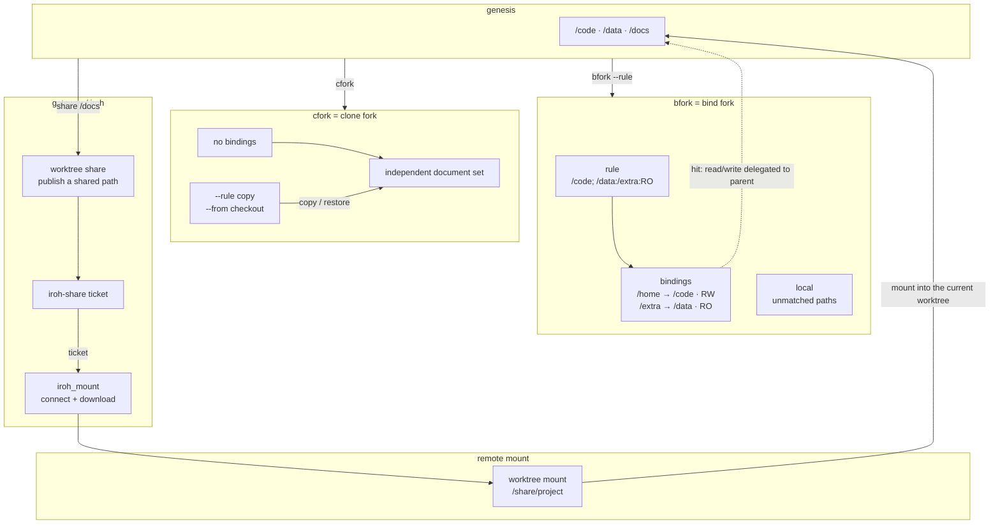

# WT

## Worktrees and snapshots

### What a worktree is

A worktree is an independent document namespace in the MDIO VFS. Switching a worktree means switching the set of documents currently being read and written; `genesis` is the default root namespace.



In the figure: `bfork` shares parent paths through bindings; `cfork` copies into an independent document set; `share/mount` only handle VFS paths and the iroh connection.

### Current and switching

- Show the current worktree
  > worktree current
- List all worktrees
  > worktree list
- Switch worktree
  > worktree use "feature"
- Return to the root worktree
  > worktree use "genesis"
- Show a worktree or a snapshot
  > worktree show "feature"
  > worktree show <hash>

### rule: how VFS paths are assembled

`rule` only appears when paths need to be shared; it describes where this worktree’s VFS paths are assembled from.

```text
/code; /data:/extra:RO
```

- First segment `/code`: maps to `/home`, RW by default
- Second segment `/data`: maps to `/extra`, `:RO` read-only
- `/share/*` segments: remote
- Paths matching no segment: use the current worktree’s own local

bindings are path mappings derived from bind segments in rule. local does not need to appear in rule — it is the default fallback.

### bfork = bind fork

`bfork` uses rule to generate bindings so the child worktree shares the parent worktree’s paths; paths not matching a binding write to its own local.

```mdio
worktree bfork "feature" --rule "/code; /data:/extra:RO"
```

- `/home` → `/code`, RW; writing `/home` goes back to the parent
- `/extra` → `/data`, RO; writing `/extra` is blocked
- Other paths write to feature’s own document set
- After creation the current worktree switches to `feature`

### cfork = clone fork

`cfork` creates no bindings; it copies the given content into its own independent document set.

```mdio
worktree cfork "clean" --rule "/docs" --from <hash>
```

- No bindings
- `--rule` is a one-off copy, not sharing
- `--from` checks out the given snapshot after forking
- After copying, it and the parent worktree do not affect each other

### Snapshots

- Commit the current state
  > worktree commit -am "save feature"
- Show status and history
  > worktree status
  > worktree log
- Show the diff between the working tree and HEAD
  > worktree diff
- Restore a snapshot
  > worktree checkout <hash>
- Undo one step
  > worktree undo

### share / mount: remote sharing

- `worktree share` publishes a local subtree as a shared path
  > worktree share /docs --as project
- gateway generates the matching ticket
- `worktree mount` mounts a remote path into the current worktree
  > worktree mount --path /share/project --from iroh://<ticket>
- After mounting, remote content is accessed through `/share/project`
- `worktree unmount` disconnects the remote path
  > worktree unmount /share/project

`mount` and `share` are path relations at the VFS layer; the actual iroh connection and sync are handled by the gateway and are not covered in the worktree section.

### Project worktrees

- `worktree load`: registers a local directory as a subtree of the current wt
  - default parent = current wt
  - `--pwt` may only be the current wt’s self or descendants; it cannot point to ancestors or siblings
  - maximum depth is 8: parent wt level + 1 must not exceed 8
  - after successful registration the current wt switches to the new wt
  > worktree load "/path/to/project" --rule "/docs"
  > worktree load "/path/to/lib" --rule "/code" --pwt "feature"
- `worktree offload`: unloads descendants of the current wt
  - only descendants can be unloaded; not self, ancestors, siblings, and genesis cannot be unloaded
  > worktree offload "project"
- wt-level operations are `load/offload`; folder-level remote operations are `mount/unmount`

### Cleanup

- Delete a snapshot
  > worktree del <hash> -f
- Delete a worktree
  > worktree rm "feature" -f
- Garbage collection and integrity check
  > worktree gc -f
  > worktree verify

### Reload

- `reload` reloads the worktree from disk files; it clears the WAL of existing files, and changes not yet written back to disk are lost
  > reload
  > reload "feature"

## Lab

- note: worktree commands run in the gateway context; `show` inspects any wt by name (including the bfork `lab` used by this page's lab).
- current: `worktree current`
- list: `worktree list`
- lab: `worktree show "lab"`
- status: `worktree status`
- log: `worktree log`
