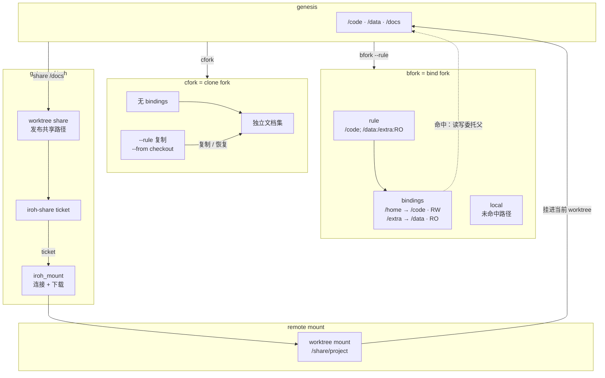

# WT

## 工作树与快照

### worktree 是什么

worktree 是 MDIO VFS 里的一个独立文档命名空间。切换 worktree，就是切换当前正在读写的那组文档；`genesis` 是默认根命名空间。



图里：`bfork` 用 bindings 共享父路径；`cfork` 复制成独立文档集；`share/mount` 只负责 VFS 路径和 iroh 连接。

### 当前与切换

- 查看当前 worktree
  > worktree current
- 列出所有 worktree
  > worktree list
- 切换 worktree
  > worktree use "feature"
- 回到根 worktree
  > worktree use "genesis"
- 查看某个 worktree 或快照
  > worktree show "feature"
  > worktree show <hash>

### rule：VFS 路径的组装规则

`rule` 只在需要共享路径时出现，它描述这个 worktree 的 VFS 路径从哪里组装。

```text
/code; /data:/extra:RO
```

- 第一段 `/code`：映射为 `/home`，默认 RW
- 第二段 `/data`：映射为 `/extra`，`:RO` 只读
- `/share/*` 段：remote
- 没命中任何段的路径：走当前 worktree 自己的 local

bindings 是 rule 中 bind 段派生出来的路径映射。local 不需要写进 rule，它是默认兜底。

### bfork = bind fork

`bfork` 用 rule 生成 bindings，让子 worktree 共享父 worktree 的路径；未命中 binding 的路径写自己的 local。

```mdio
worktree bfork "feature" --rule "/code; /data:/extra:RO"
```

- `/home` → `/code`，RW；写 `/home` 会回父
- `/extra` → `/data`，RO；写 `/extra` 会被拦截
- 其他路径写 feature 自己的文档集
- 创建后当前 worktree 切到 `feature`

### cfork = clone fork

`cfork` 不建立 bindings；它把指定内容复制成自己的独立文档集。

```mdio
worktree cfork "clean" --rule "/docs" --from <hash>
```

- 没有 bindings
- `--rule` 只做一次性复制，不是共享
- `--from` 是 fork 后 checkout 指定快照
- 复制完成后和父 worktree 互不影响

### 快照

- 提交当前状态
  > worktree commit -am "save feature"
- 查看状态与历史
  > worktree status
  > worktree log
- 查看工作区与 HEAD 的差异
  > worktree diff
- 恢复快照
  > worktree checkout <hash>
- 回退一步
  > worktree undo

### share / mount：远程共享

- `worktree share` 把本地子树发布为共享路径
  > worktree share /docs --as project
- gateway 生成对应 ticket
- `worktree mount` 把远程路径挂进当前 worktree
  > worktree mount --path /share/project --from iroh://<ticket>
- 挂载后通过 `/share/project` 访问远程内容
- `worktree unmount` 断开远程路径
  > worktree unmount /share/project

`mount` 和 `share` 是 VFS 层的路径关系；具体的 iroh 连接和同步由 gateway 处理，不在 worktree 章展开。

### 项目 worktree

- `worktree load`：把本地目录注册为当前 wt 的子树
  - 默认 parent = 当前 wt
  - `--pwt` 只能是当前 wt 的 self 或后代；不能指向祖先或兄弟
  - 层级上限 8：父 wt 的 level + 1 不能超过 8
  - 注册成功后当前 wt 切到新 wt
  > worktree load "/path/to/project" --rule "/docs"
  > worktree load "/path/to/lib" --rule "/code" --pwt "feature"
- `worktree offload`：卸载当前 wt 的后代
  - 只能卸载后代；不能 self、祖先、兄弟，也不能卸载 genesis
  > worktree offload "project"
- wt 级操作是 `load/offload`；folder 级远程操作是 `mount/unmount`

### 清理

- 删除快照
  > worktree del <hash> -f
- 删除 worktree
  > worktree rm "feature" -f
- 垃圾回收与完整性检查
  > worktree gc -f
  > worktree verify

### 重新加载

- `reload` 以磁盘文件为准重载 worktree；会清掉现有文件的 WAL，尚未写回磁盘的修改会丢
  > reload
  > reload "feature"

## 实验台

- note: worktree 命令按网关上下文执行；`show` 可以按名字查看任意 wt（含本页实验用的 bfork `lab`）。
- current: `worktree current`
- list: `worktree list`
- lab: `worktree show "lab"`
- status: `worktree status`
- log: `worktree log`
